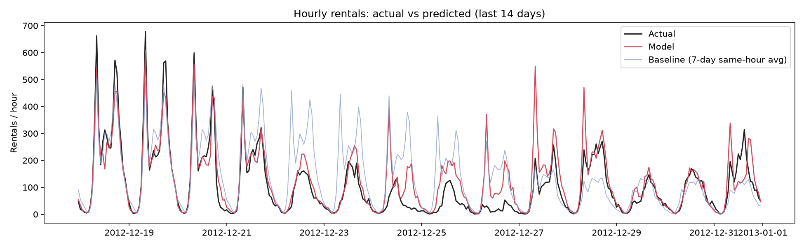
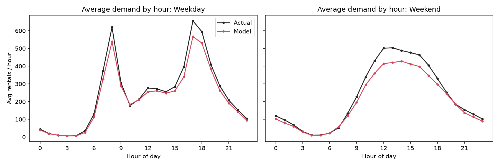
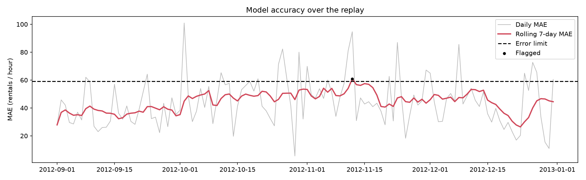

<# Bike Demand Forecaster

Forecasts hourly bike-rental demand, serves predictions through a REST API, and monitors the model for accuracy decay by replaying held-out data one day at a time into PostgreSQL.

**Stack:** Python, pandas, scikit-learn, FastAPI, PostgreSQL, SQLAlchemy, matplotlib

**Dataset:** [UCI Bike Sharing](https://archive.ics.uci.edu/dataset/275/bike+sharing+dataset), hourly Capital Bikeshare rentals for Washington DC (2011-2012). The data is system-wide, so the model forecasts total demand across the whole network, not per station.

---

## Results

The model was trained on data up to 2012-08-31 and tested on the following 122 days (Sep-Dec 2012). The split is chronological, never shuffled, so the model is always predicting a future it has not seen.

| Model | MAE (rentals / hour) |
|---|---|
| Baseline: average of the same hour over the previous 7 days | 85.26 |
| **Gradient boosting model** | **44.67** |
| Validation MAE (inside the training period) | 39.37 |

The model cuts error by about **48%** versus the baseline. Its error on the future period is about 13% higher than on validation, which is the kind of gap you would expect when predicting beyond the training window.

### Predicted vs. actual demand



The model tracks weekday commute spikes closely and beats the baseline, which keeps over-predicting. It fails during Christmas week (see Limitations).

### Peak hours



The model gets the shape right: weekday peaks at 8am and 5-6pm, and a midday hump on weekends. It under-predicts peak levels by roughly 13-17%.

### Accuracy monitoring during replay



Rolling 7-day MAE stays mostly between 35 and 55 and crosses the error limit (59.06) once, around 2012-11-11, which sets the model's `flagged` status.

---

## How it works

| Step | Description | File |
|---|---|---|
| Baseline | Mean rentals at the same hour over the previous 7 days, using only earlier days | `bikeforecast/baseline.py` |
| Features | Hour, weekday, season, month, holiday, working day, weather, temperature, humidity, wind | `bikeforecast/features.py` |
| Training | Gradient boosting with Poisson loss (demand is a count). Validation on Jul-Aug 2012 sets the normal error level | `bikeforecast/train.py` |
| API | Hourly and daily predictions with input validation, plus a model-health endpoint | `bikeforecast/api.py` |
| Storage | Every prediction and its actual outcome saved to PostgreSQL | `bikeforecast/db.py` |
| Replay | Predict a day, reveal the actuals, store results, update monitoring, one day at a time | `bikeforecast/replay.py` |
| Drift flag | Model is flagged when rolling 7-day MAE exceeds 1.5x validation MAE. Daily error trend is also stored | `bikeforecast/replay.py` |
| Charts | Predicted vs. actual, peak hours, error over time | `bikeforecast/visualize.py` |

## API

Start the server and open the interactive docs at `http://127.0.0.1:8000/docs`.

| Endpoint | Purpose |
|---|---|
| `POST /predict/hour` | Predicted rentals for one future hour |
| `POST /predict/day` | Predicted rentals for all 24 hours, daily total and peak hour |
| `GET /monitoring/status` | Latest rolling MAE, error limit and flag status from the database |
| `GET /health` | Service check |

Example:

```bash
curl -X POST http://127.0.0.1:8000/predict/hour \
  -H "Content-Type: application/json" \
  -d '{"timestamp": "2012-12-20T08:00:00", "temp_c": 12, "humidity_pct": 60, "windspeed_kmh": 10, "weather": 1}'
```

Returns `{"timestamp": "...", "predicted_rentals": ...}`.

`weather` is 1 (clear), 2 (mist/cloudy), 3 (light rain/snow) or 4 (heavy rain/snow). Set `"holiday": true` for holidays.

## Run it locally

Requires Python 3.10+ and PostgreSQL.

```bash
git clone https://github.com/Vineeth-4/bike-demand-forecaster.git
cd bike-demand-forecaster
python -m venv .venv
.venv\Scripts\activate          # Mac/Linux: source .venv/bin/activate
pip install -r requirements.txt
```

Create the database (in `psql` or pgAdmin):

```sql
CREATE USER bike WITH PASSWORD 'bike';
CREATE DATABASE bike OWNER bike;
```

Then run the pipeline in order:

```bash
python -m bikeforecast.train        # downloads data, trains, saves model and metrics
python -m bikeforecast.replay       # day-by-day replay into PostgreSQL
python -m bikeforecast.visualize    # charts in reports/
python -m uvicorn bikeforecast.api:app --reload
pytest                              # unit tests
```

To use a different database, set `DATABASE_URL`. For example, `sqlite:///test.db` runs everything without PostgreSQL.

If the automatic download fails, download the dataset from the UCI page and place `hour.csv` in `data/`. `scripts/make_synthetic_data.py` generates fake data with the same schema for offline testing.

## Project structure

```
bikeforecast/
  config.py       settings: split date, error limit, database URL
  data.py         dataset download, loading, chronological split
  features.py     feature engineering (shared by training and API)
  baseline.py     same-hour moving average
  train.py        model training and evaluation
  api.py          FastAPI service
  db.py           SQLAlchemy models
  replay.py       day-by-day replay and drift monitoring
  visualize.py    report charts
scripts/          synthetic data generator
tests/            unit tests
docs/             charts used in this README
```

## Limitations

These are findings from the replay, not just caveats.

- **System-wide only.** The dataset has no station information. A per-station version would need Capital Bikeshare trip data aggregated by start station.
- **Holiday weeks.** The model badly over-predicts demand in Christmas week (Dec 26-27 and Dec 31). The dataset's `holiday` flag marks only official holidays, and with one Christmas in the training data the model never learned that the whole week behaves differently.
- **Peak under-prediction.** Peak hours are under-predicted by about 13-17%. The hourly shape is correct and overnight hours are accurate, so this is a level problem. It most likely comes from demand growing between 2011 and 2012 faster than the model could capture from the training window.
- **Perfect weather assumption.** The replay uses actual weather as if it were a perfect forecast. With real forecast weather, expect higher error.
- **Short history.** Two years of data means no reliable multi-year seasonality.

## What I'd do next

- Retrain on a schedule (for example weekly on an expanding window) and when the drift flag fires. This should fix the peak under-prediction.
- Require several consecutive days above the error limit before flagging, to reduce false alarms.
- Add a normalized error metric (WAPE) alongside MAE, so a drop in demand is not mistaken for a better model.
- Add holiday-proximity features, and prediction intervals through quantile regression.
- Containerize the API and run tests in GitHub Actions.
